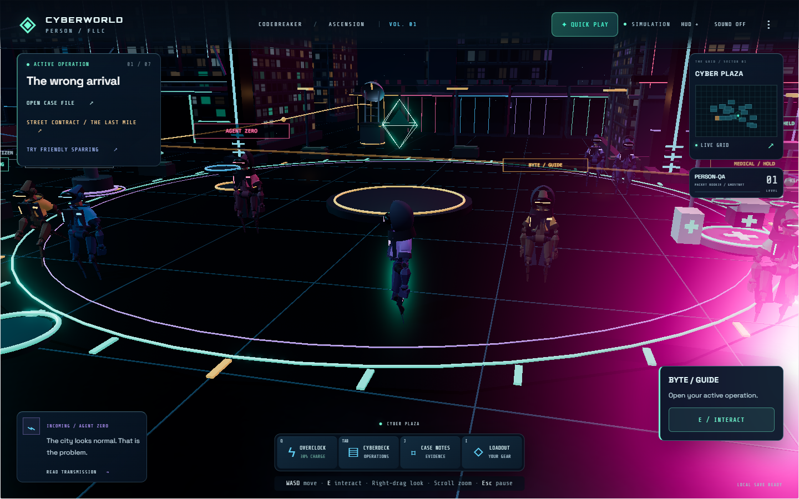
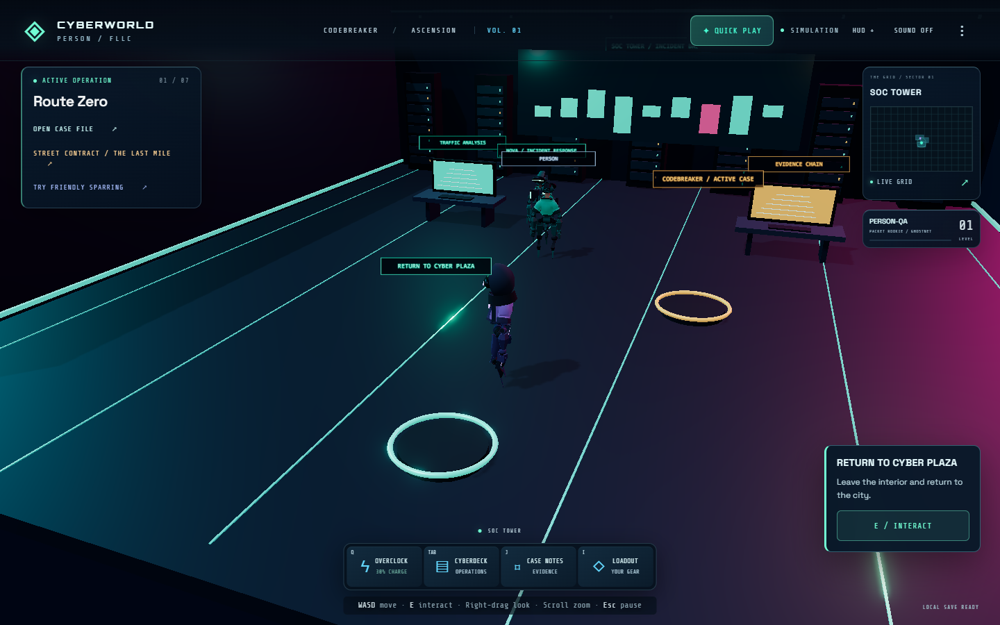

# CYBERWORLD // CODEBREAKER: ASCENSION

**Your superpower is visibility.**

An original 3D browser cybersecurity RPG inside Person's operator desktop. Create an operative, walk Cyber Plaza, meet Agent Zero, and follow a suspicious freight manifest through seven connected investigations. The world, character preview and containment arena render real 3D geometry with WebGL.

**Public alpha:** a playable opening district and campaign. The larger AAA/MMO vision remains in production; [release notes](docs/RELEASE-NOTES.md) distinguish shipped behavior from outstanding work.

[Enter the Grid](https://personfu.github.io/CyberWorld/ascension.html) · [Operator desktop](https://personfu.github.io/) · [Source and design](docs/ASCENSION-DESIGN.md)

## Play

No download or account is required. Use a modern browser with WebGL2. First load downloads the public game; the scoped service worker then supports local offline play. Guest presence connects to the public grid when available, with truthful solo or same-browser fallback.

- **WASD / arrows:** move; **Shift:** run; **E:** interact.
- **Mouse:** click to walk; drag to orbit the camera; scroll to zoom.
- **Q:** OVERCLOCK; **Tab:** Cyberdeck; **J:** case notes; **I:** equipment; **Esc:** pause.
- **M:** city map; **H:** show/hide detailed HUD. Graphics settings include Low, Medium, High, Ultra and Custom.
- Touch movement and interaction controls appear on phones/tablets. A connected gamepad supports movement, interaction and the Cyberdeck.

## What's playable

- An original 3D city, operative creator, NPCs and district interiors.
- A walkable rooftop, hidden relay, moving citizens, remembered conversations, quartermaster, and a physical three-signature field route.
- Seven connected cases: packet reassembly, static analysis, DNS triage, repeated-keystream reasoning, bounds validation, SHA-256 provenance, and incident reconstruction.
- A 3D containment encounter: preserve evidence, isolate only the affected producer, rotate its token, restore a trusted route and verify clean deliveries.
- OVERCLOCK slows the simulation and exposes relationships while you retain responsibility for the finding.
- XP, unlockable equipment, a case notebook, debriefs, educational Codex, Academy and Arcade.
- Actual guest presence and bounded position updates. NPCs are never represented as online players.
- Versioned local progress, legacy-save preservation, bounded export/import and settings for sound and reduced motion.

## Screenshots





[Watch 33 seconds of actual gameplay](docs/qa/opening-gameplay.webm) · [Independent critique](docs/qa/independent-critique.md)

## Development

Use Node.js 22+:

```sh
npm ci
npm run typecheck
npm run lint
npm run build
npm test
npm run test:browser
node scripts/preview-ascension.cjs
```

Open the local URL printed by the preview server. Browser checks use installed Chrome; no browser is downloaded during dependency installation.

Start **Play Blackout Run → Start** for the short action mission without a character form or technical quiz. The title also offers Create Operative; Quick Play contains five gentle adventures, and the seven investigations include optional coaching. See [Blackout Run](docs/BLACKOUT-RUN.md) and [beginner design](docs/BEGINNER-DESIGN.md).

Three.js sources live in `CyberWorld/src/`. The build bundles them into static browser scripts and verifies asset closure. GitHub Pages serves the source tree directly; no framework server is needed. Existing compiled Next assets and the previous canvas world remain preserved.

The TypeScript check parses the legacy/new JavaScript and validates strict bridge contracts; this repository does not claim complete semantic typing of every archived script. See [verification scope](docs/ascension-verification.md).

## Architecture and boundaries

The public Ascension route is separate from the FLLC protected member grid. The original Win98 desktop, GovINT, Signal Vault, existing Academy, archived games and member links remain connected. The new scoped service worker caches an explicit list of public assets and retains member gateway behavior.

All security exercises manipulate fictional local game state. There is no scanner, shell execution, remote exploit, or competitive score authority. Guest networking shares only bounded game identity/position fields, never account email or save exports. Progress remains local; authenticated cloud saves, moderation and authoritative co-op progression are later milestones. See [network review](docs/ascension-network.md).

The seven-case Black Freight campaign is original and does not publish live NSA Codebreaker answers. Agency-inspired liaisons and sourced historical threat research are educational context. CyberWorld is independent and is not sponsored or endorsed by NSA, FBI, CIA, CISA or NASA. Its characters, world and art do not use Matrix game assets.

## Next production milestones

The [design and release guide](docs/ASCENSION-DESIGN.md) maps the large world brief into the shipped game slice and subsequent production phases: expanded Signal/Archive/Identity districts; cooperative investigations with authoritative shared state; reviewed cloud-save policies; hardware and orbital/NASA-inspired educational campaigns; and broader device, audio, animation and accessibility testing. These are roadmap items, not claims of shipped features.

## Contribute

Read [AGENTS.md](AGENTS.md). Preserve existing routes and saves, write original content, include a defensive lesson with every simulated threat, and run all relevant checks. Add authored missions through the campaign schema rather than another disconnected game launcher.

Three.js is used under its MIT license. See [art and source notes](docs/ASCENSION-ART.md) for original asset provenance and the distinction between generated illustration and the actual 3D runtime.
